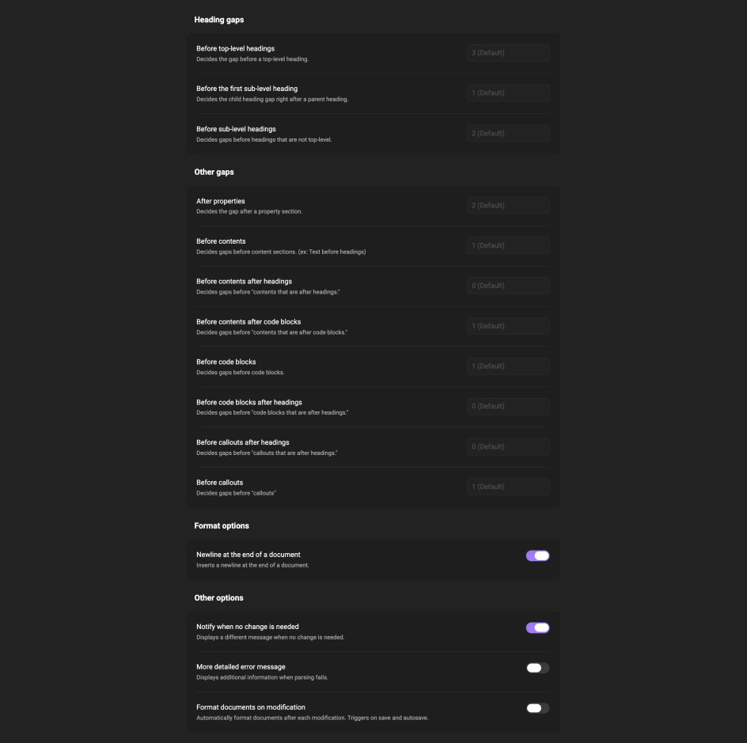

# Formative

- [Official Repository](https://gitlab.com/elaraspace/formative)
- [GitHub Mirror](https://github.com/elaraspace/formative)
- [Releases](https://github.com/elaraspace/formative/releases)

Formative is a fork of [Formatto](https://github.com/stellacube/formatto). It provides Rust-powered Markdown formatting features on [Obsidian](https://obsidian.md/). Users can configure the plugin to customize it.

    
    

## How to Use
You can use the plugin in following ways:

- Right click in the editor and select "Format Document"
- Run a command "Formative: Format Document" (or assign a keyboard shortcut to the command)
- Click "Format Document" ribbon action

## This plugin works best in "source mode."
Obsidian uses "live preview" as the default editing mode. But this plugin was designed to work best in "source mode." You can change the editing mode here:

- Options -> Editor -> Default editing mode

## Contributing
If you're interested in participating in this project, please refer to the
[contribution guide](https://gitlab.com/elaraspace/formative/blob/main/CONTRIBUTING.md).
